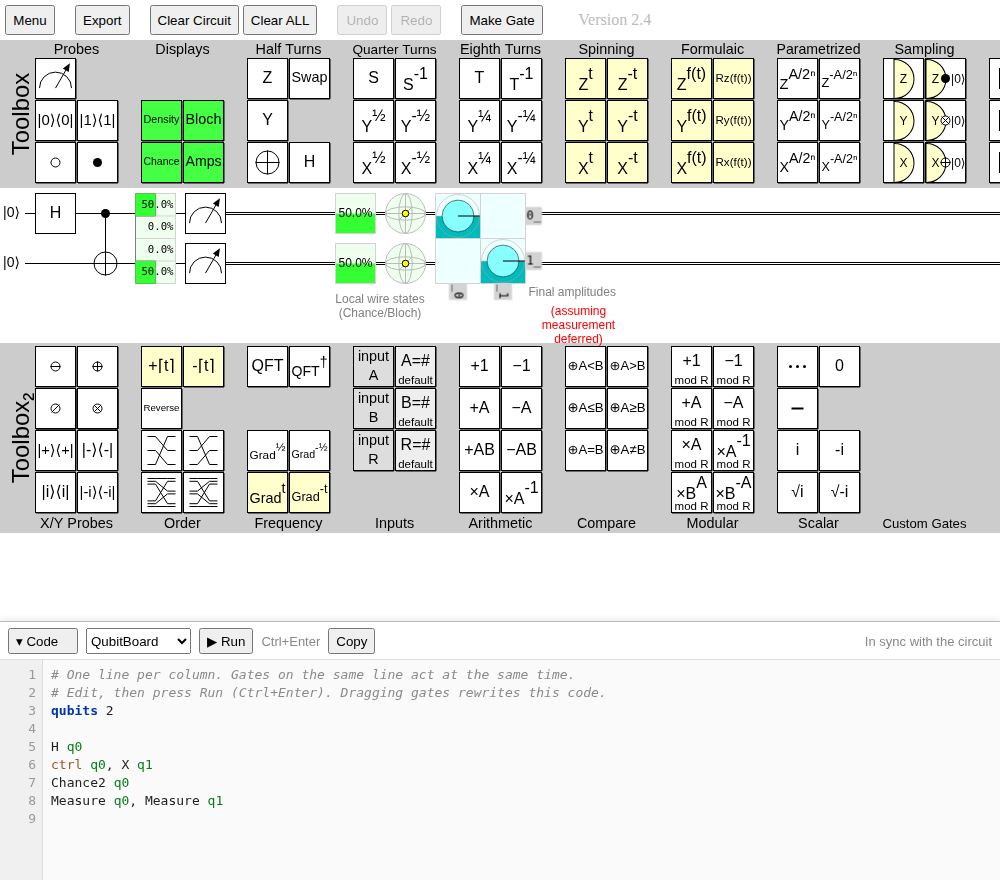

# The code panel

The code panel at the bottom of the page shows the current circuit as code, and lets you build or edit a circuit by typing instead of dragging.

## Keeping code and circuit in sync

The panel and the circuit stay in sync in both directions, but in different ways:

- **Circuit → code, instantly.**
  Every change you make to the circuit (dropping a gate, clicking, undo, redo, opening a link) rewrites the code straight away.
  If you had typed changes that you hadn't run yet, they are replaced.
- **Code → circuit, when you run it.**
  Typing doesn't touch the circuit, like a notebook cell.
  Click **▶ Run** or press **Ctrl+Enter** to apply the code.
  A run is a single undo step, so the **Undo** button reverts it.
  If the code has a mistake, the status bar says what's wrong, the line is marked in red, and the circuit is left unchanged.

## Using the panel

- Choose the language from the drop-down next to the **Code** button: **Cirq** (the default), **OpenQASM 3** or **QubitBoard**. The code is rewritten in the new language right away.
- While you're typing in the panel, Ctrl+Z and Ctrl+Y undo and redo your typing, not the circuit.
- **Copy** copies the code. **▾ Code** minimises the panel to a thin bar, and **▸ Code** brings it back. QubitBoard
  remembers whether the panel was minimised. Drag the panel's top edge to resize it.
- Tab indents. Press Escape to move focus out of the editor.

## Languages

| Language | What it is |
|----------|------------|
| [Cirq](cirq.md) | Google's Python library for quantum circuits, and the default. The code runs as it is in Python. |
| [OpenQASM 3](openqasm.md) | The standard text format for quantum circuits, used by Qiskit and many other tools. |
| [QubitBoard](qubitboard-language.md) | QubitBoard's own language. It can describe everything QubitBoard can simulate. |

Cirq and OpenQASM have no equivalent for some of QubitBoard's gates, such as displays.
Those gates are written on `@qb` comment lines in the QubitBoard language, which other tools ignore and QubitBoard reads back, so nothing is lost when you run the code.
