# Bottom toolbox

The bottom toolbox holds the more specialized gates: X and Y axis probes, gates that act on several qubits as a number, and global phases.
The sections below are its groups, from left to right.
[Gates](index.md) explains the table columns.

## X/Y Probes

The controls and postselection gates of the [Probes](top-toolbox.md#probes) group, along the X and Y axes instead of the Z axis.

| Gate | Name | Id | What it does |
|------|------|----|--------------|
| 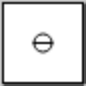 | X-Axis Anti-Control | `⊕` or `xnegctrl` | Conditions on a qubit being \|+⟩. |
| 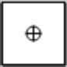 | X-Axis Control | `⊖` or `xctrl` | Conditions on a qubit being \|-⟩. |
|  | Y-Axis Anti-Control | `⊗` or `ynegctrl` | Conditions on a qubit being \|i⟩. |
|  | Y-Axis Control | `(/)` or `yctrl` | Conditions on a qubit being \|-i⟩. |
| 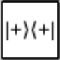 | Postselect X-Off | `\|+⟩⟨+\|` or `postxoff` | Keeps \|+⟩ states, discards/retries \|-⟩ states. |
| 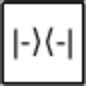 | Postselect X-On | `\|-⟩⟨-\|` or `postxon` | Keeps \|-⟩ states, discards/retries \|+⟩ states. |
| 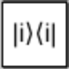 | Postselect Y-Off | `\|X⟩⟨X\|` or `postyoff` | Keeps \|i⟩ states, discards/retries \|-i⟩ states. |
| 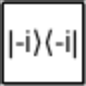 | Postselect Y-On | `\|/⟩⟨/\|` or `postyon` | Keeps \|-i⟩ states, discards/retries \|i⟩ states. |

- As with the Z-axis controls, gates in the same column only apply to states meeting the condition.
- An X-axis control is a Z-axis control with a Hadamard gate before and after it.
- **The ids of the four controls don't match their labels.** Each control's id is the symbol drawn on its opposite: the X-axis control is drawn as ⊕ but its id is `⊖`. The plain-text names avoid the confusion.
- These controls aren't common in papers or textbooks. See [XYZ controls](../reference/conventions.md#xyz-controls).

## Order

Gates that treat a block of qubits as a number to count with, or that move qubits around.

| Gate | Name | Id | Sizes | What it does |
|------|------|----|-------|--------------|
| 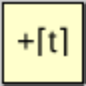 | Counting Gate | `Counting3` | 1–16 | Adds an increasing little-endian count into a block of qubits. |
| 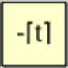 | Down Counting Gate | `Uncounting3` | 1–16 | Subtracts an increasing little-endian count from a block of qubits. |
|  | Reverse Order | `rev2` | 2–16 | Swaps bits into the opposite order. |
|  | Left Rotate | `<<3` | 2–16 | Rotates bits downward. |
|  | Right Rotate | `>>3` | 2–16 | Rotates bits upward. |
|  | Interleave | `weave6` | 4–16 | Re-orders blocks of bits into stripes of bits. |
|  | Deinterleave | `split6` | 4–16 | Re-orders stripes of bits into blocks of bits. |

- **Counting.** The count grows with [time](index.md#time): over one cycle an n-qubit counting gate adds 0, then 1, and so on up to 2ⁿ − 1.
- **Rotating.** Left Rotate moves each qubit's value one wire down, and the bottom wire's value wraps around to the top. Right Rotate is its inverse.
- **Interleaving.** Interleave takes the top half and the bottom half of its wires and alternates them. Deinterleave is its inverse.
## Frequency

The quantum Fourier transform and the phase gradient gates.

| Gate | Name | Id | Sizes | What it does |
|------|------|----|-------|--------------|
|  | Fourier Transform Gate | `QFT2` | 1–16 | Transforms to/from phase frequency space. |
| 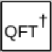 | Inverse Fourier Transform Gate | `QFT†2` or `QFTdag2` | 1–16 | Transforms from/to phase frequency space. |
| 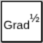 | Half Gradient Gate | `PhaseGradient2` | 1–16 | Phases the target by an amount proportional to its value. |
| 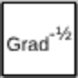 | Inverse Half Gradient Gate | `PhaseUngradient2` | 1–16 | Counter-phases the target by an amount proportional to its value. |
| 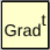 | Cycling Gradient Gate | `grad^t2` | 1–16 | Phases the target by a cycling amount proportional to its value. |
| 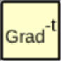 | Inverse Cycling Gradient Gate | `grad^-t2` | 1–16 | Counter-phases the target by a cycling amount proportional to its value. |

- **Half gradient.** On n qubits, the state with value k is multiplied by e^(iπk/2ⁿ). For two qubits that is the diagonal matrix with entries 1, e^(iπ/4), i and e^(3iπ/4).
- **Cycling gradient.** The same idea, with a phase that grows with [time](index.md#time) instead of being fixed.
- The values are read with the top wire as the low bit. See [Qubit order](../reference/conventions.md#qubit-order).

## Inputs

Gates that supply the values A, B and R to gates in the other groups.
They have no effect of their own.

| Gate | Name | Id | Sizes | What it does |
|------|------|----|-------|--------------|
| 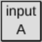 | Input Gate [A] | `inputA2` | 1–16 | Temporarily uses some qubits as input A. |
| 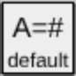 | Set Default A | `setA` | | Sets a default value for input A, for when an inline input isn't given. |
| 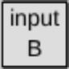 | Input Gate [B] | `inputB2` | 1–16 | Temporarily uses some qubits as input B. |
| 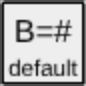 | Set Default B | `setB` | | Sets a default value for input B, for when an inline input isn't given. |
| 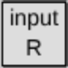 | Input Gate [R] | `inputR2` | 1–16 | Temporarily uses some qubits as input R. |
| 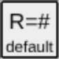 | Set Default R | `setR` | | Sets a default value for input R, for when an inline input isn't given. |

- **Input gates** mark the qubits they cover as a value for the other gates in the same column.
- **Set Default gates** give a fixed number instead, which applies to the columns after them. Click the gate in the circuit to enter a whole number from 0 to 65535. In code the number goes in square brackets, as in `setA[5]`.
- **Which gates use them.** [Parametrized](top-toolbox.md#parametrized) rotations use A. [Arithmetic](#arithmetic) uses A and B. [Compare](#compare) uses A and B. [Modular](#modular) uses A, B and R.
- A gate that is missing one of its inputs is disabled until the input is supplied.
- Inputs are read with the top wire as the low bit. Input gates with the opposite order exist but aren't in the toolbox. See [Unlisted gates](unlisted-gates.md).

## Arithmetic

Gates that treat the qubits they cover as a little-endian number and do arithmetic on it.
Results wrap around: an n-qubit gate works modulo 2ⁿ.
[Arithmetic](../guide/arithmetic.md) in the guide gives a worked description.

| Gate | Name | Id | Sizes | What it does |
|------|------|----|-------|--------------|
| 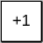 | Increment Gate | `inc2` | 1–16 | Adds 1 to the little-endian number represented by a block of qubits. |
| 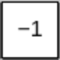 | Decrement Gate | `dec2` | 1–16 | Subtracts 1 from the little-endian number represented by a block of qubits. |
| 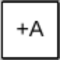 | Addition Gate [input A] | `+=A2` | 1–16 | Adds input A into the qubits covered by this gate. |
| 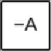 | Subtraction Gate [input A] | `-=A2` | 1–16 | Subtracts input A out of the qubits covered by this gate. |
| 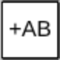 | Multiply-Add Gate [Inputs A, B] | `+=AB2` | 1–16 | Adds the product of inputs A and B into the qubits covered by this gate. |
| 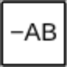 | Multiply-Subtract Gate [Inputs A, B] | `-=AB2` | 1–16 | Subtracts the product of inputs A and B out of the qubits covered by this gate. |
| 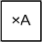 | Multiplication Gate | `*A2` | 1–16 | Multiplies the target by input A. |
| 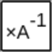 | Inverse Multiplication Gate | `/A2` | 1–16 | Inverse-multiplies the target by input A (modulo 2ⁿ). |

- The two multiplication gates have no effect when input A is even, because multiplying by an even number modulo 2ⁿ can't be undone.
- More arithmetic gates, such as XOR and square-accumulate, are listed under [Unlisted gates](unlisted-gates.md).

## Compare

Single-qubit gates that toggle their qubit when a comparison between [inputs](#inputs) A and B holds.

| Gate | Name | Id | What it does |
|------|------|----|--------------|
| 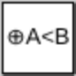 | Less-Than Gate | `^A<B` | Toggles a qubit if input A is less than input B. |
| 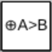 | Greater-Than Gate | `^A>B` | Toggles a qubit if input A is greater than input B. |
| 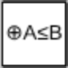 | At-Most Gate | `^A<=B` | Toggles a qubit if input A is at most input B. |
| 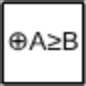 | At-Least Gate | `^A>=B` | Toggles a qubit if input A is at least input B. |
| 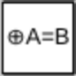 | Equality Gate | `^A=B` | Toggles a qubit if input A is equal to input B. |
| 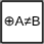 | Inequality Gate | `^A!=B` | Toggles a qubit if input A isn't equal to input B. |

- The alternate of each gate is its opposite: Less-Than and At-Least, Greater-Than and At-Most, Equality and Inequality.

## Modular

Arithmetic modulo [input R](#inputs) instead of modulo a power of two.
These gates only affect values less than R; larger values are left as they are, which keeps the operation reversible.

| Gate | Name | Id | Sizes | What it does |
|------|------|----|-------|--------------|
| 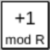 | Modular Increment Gate | `incmodR2` | 1–16 | Adds 1 into the target, but wraps R-1 to 0. |
| 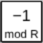 | Modular Decrement Gate | `decmodR2` | 1–16 | Subtracts 1 out of the target, but wraps 0 to R-1. |
| 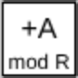 | Modular Addition Gate | `+AmodR2` | 1–16 | Adds input A into the target, mod input R. |
| 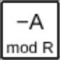 | Modular Subtraction Gate | `-AmodR2` | 1–16 | Subtracts input A out of the target, mod input R. |
| 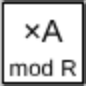 | Modular Multiplication Gate | `*AmodR2` | 1–16 | Multiplies the target by input A mod input R. |
| 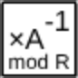 | Modular Division Gate | `/AmodR2` | 1–16 | Inverse-multiplies the target by input A mod input R. |
| 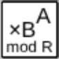 | Modular Power Multiplication Gate | `*BToAmodR2` | 1–16 | Multiplies the target by input B raised to the input A mod input R. |
| 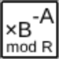 | Modular Power Division Gate | `/BToAmodR2` | 1–16 | Inverse-multiplies the target by input B raised to the input A mod input R. |

- The four multiplication and division gates have no effect when the multiplication would be irreversible, which happens when the multiplier shares a factor with R.

## Scalar

Gates that multiply the whole state by a number, plus the spacer.
A global phase has no visible effect on its own, but it becomes a relative phase once the gate is controlled.

| Gate | Name | Id | What it does |
|------|------|----|--------------|
| 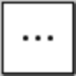 | Spacer | `…` or `spacer` | A gate with no effect. |
| 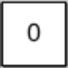 | Nothing Gate | `0` | Destroys the universe. |
| 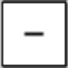 | Ne-Gate | `NeGate` | Negates all amplitudes. |
| 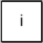 | Imaginary Gate | `i` | Phases everything by i. |
| 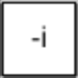 | Anti-Imaginary Gate | `-i` | Phases everything by -i. |
| 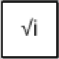 | Half Imaginary Gate | `√i` or `sqrti` | Phases everything by √i. |
| 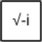 | Half Anti-Imaginary Gate | `√-i` or `sqrt-i` | Phases everything by √-i. |

- **Spacer.** Use it to hold a position in a column without doing anything there.
- **Nothing Gate.** A joke gate. Its matrix is all zeros, so every amplitude becomes 0.
- **Ne-Gate.** Multiplies the state by -1.
