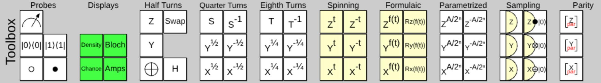
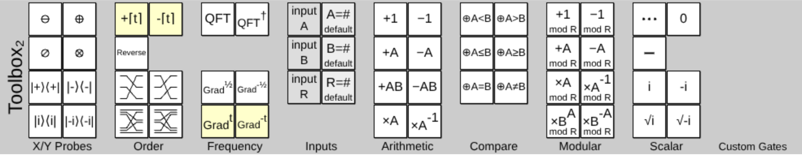

# Gates

QubitBoard's gates live in two toolboxes, one above the circuit and one below it.
Each toolbox is divided into named groups.
These pages follow the same layout: one page per toolbox, with one section per group, in the order the groups appear on screen.

## The top toolbox

| Group | What's in it |
|-------|--------------|
| [Probes](top-toolbox.md#probes) | Measurement, postselection and controls |
| [Displays](top-toolbox.md#displays) | Density matrix, Bloch sphere, chance and amplitude displays |
| [Half Turns](top-toolbox.md#half-turns) | The Pauli gates, Hadamard and Swap |
| [Quarter Turns](top-toolbox.md#quarter-turns) | Square roots of the Pauli gates, such as S |
| [Eighth Turns](top-toolbox.md#eighth-turns) | Fourth roots of the Pauli gates, such as T |
| [Spinning](top-toolbox.md#spinning) | Rotations that turn continuously as time passes |
| [Formulaic](top-toolbox.md#formulaic) | Rotations by a formula that you type |
| [Parametrized](top-toolbox.md#parametrized) | Rotations by an amount read from other qubits |
| [Sampling](top-toolbox.md#sampling) | Detectors, which measure by sampling |
| [Parity](top-toolbox.md#parity) | Controls on the parity of several qubits |

## The bottom toolbox

| Group | What's in it |
|-------|--------------|
| [X/Y Probes](bottom-toolbox.md#x-y-probes) | Controls and postselection along the X and Y axes |
| [Order](bottom-toolbox.md#order) | Counting gates and gates that re-order qubits |
| [Frequency](bottom-toolbox.md#frequency) | Fourier transforms and phase gradients |
| [Inputs](bottom-toolbox.md#inputs) | Gates that supply the values A, B and R to other gates |
| [Arithmetic](bottom-toolbox.md#arithmetic) | Increment, add and multiply |
| [Compare](bottom-toolbox.md#compare) | Toggle a qubit by comparing two inputs |
| [Modular](bottom-toolbox.md#modular) | Arithmetic modulo the input R |
| [Scalar](bottom-toolbox.md#scalar) | Global phases and the spacer |

Gates that you make with **Make Gate** appear in a **Custom Gates** group at the end of the bottom toolbox.
QubitBoard also has gates that aren't in either toolbox: see [Unlisted gates](unlisted-gates.md).

## Reading the tables

Each section has a table with these columns:

- **Gate** is a picture of the gate as it appears in the toolbox.
- **Name** is the title of the tooltip shown when you hover over the gate.
- **Id** is how the gate is written in [the QubitBoard language](../code/qubitboard-language.md) and in [circuit links](../reference/circuit-links.md). When an id has characters that are hard to type, the plain-text name that the code panel also accepts is given after it.
- **Sizes** is the number of wires the gate can cover, for gates that can be resized.
- **Matrix** is the gate's matrix, written in the `{{row}, {row}}` form that custom gates use.

## Behaviour shared by many gates

### Resizing

A gate that covers several wires has a resize tab at its bottom edge once it is in the circuit. Drag the tab to change the number of wires.
In code and in links the size is the number at the end of the id, so `QFT2` is a two-qubit Fourier transform and `QFT5` a five-qubit one.

### Alternates

Hold *alt* when you start dragging a gate to get its alternate.
For most gates this is the inverse, which is the gate next to it in the toolbox: Z^½ and Z^-½, +1 and −1, the control and the anti-control.

### Controls

A gate only applies to the states that satisfy every control in its column.
This works for displays too. See [Conditioning displays](../guide/displays.md#conditioning-displays).

### Time

Some gates change as time passes, which makes the circuit animate.
Time is a variable `t` that starts at -1, grows to +1, then jumps back to -1.
The [Spinning](top-toolbox.md#spinning) gates, the [Formulaic](top-toolbox.md#formulaic) gates, the counting gates in [Order](bottom-toolbox.md#order) and the cycling gradients in [Frequency](bottom-toolbox.md#frequency) depend on it.

### Inputs

Gates with an A, B or R in their label read that value from other qubits.
Put an input gate from the [Inputs](bottom-toolbox.md#inputs) group in the same column, or set a default value earlier in the circuit.
