# Toolbox

The toolbox above the circuit holds every gate you can drag into it.
Its groups run from left to right and wrap onto another row when the window is too narrow to show them all.
The sections below follow the same order.
[Gates](index.md) explains the table columns.

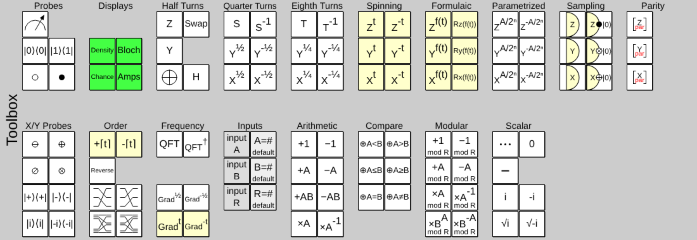

## Probes

Gates that examine a qubit or condition on it, instead of rotating it.

| Gate | Name | Id | What it does |
|------|------|----|--------------|
| 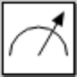 | Measurement Gate | `Measure` | Measures whether a qubit is ON or OFF, without conditioning on the result. |
| 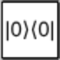 | Postselect Off | `\|0⟩⟨0\|` or `postoff` | Keeps OFF states, discards/retries ON states. |
| 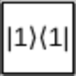 | Postselect On | `\|1⟩⟨1\|` or `poston` | Keeps ON states, discards/retries OFF states. |
| 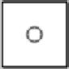 | Anti-Control | `◦` or `negctrl` | Conditions on a qubit being OFF. Gates in the same column only apply to states meeting the condition. |
| 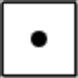 | Control | `•` or `ctrl` | Conditions on a qubit being ON. Gates in the same column only apply to states meeting the condition. |

- **Measurement.** A measured qubit can't be unmeasured. [Measurement and detectors](../guide/measurement.md) explains how this gate differs from a detector.
- **Postselection.** A postselection gate keeps only the part of the state where the qubit has the given value, as if the experiment were repeated until that outcome came up. Its matrix is a projector: `{{1, 0}, {0, 0}}` for Postselect Off and `{{0, 0}, {0, 1}}` for Postselect On.
- **Controls.** A column can hold any number of controls, and they apply to every other gate in the column, displays included. To make a CNOT, put a control and an X gate in the same column. Controls along the X and Y axes are under [X/Y Probes](#x-y-probes).

## Displays

Displays show the state at the point where you place them. They don't change it.
[Displays](../guide/displays.md) describes each one, with pictures.

| Gate | Name | Id | Sizes | What it does |
|------|------|----|-------|--------------|
| 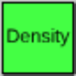 | Density Matrix Display | `Density` | 1–8 | Shows the density matrix of the local mixed state of some wires. |
| 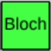 | Bloch Sphere Display | `Bloch` | 1 | Shows a wire's local state as a point on the Bloch sphere. |
|  | Probability Display | `Chance` | 1–16 | Shows chances of outcomes if a measurement was performed. |
| 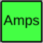 | Amplitude Display | `Amps2` | 1–16 | Shows the amplitudes of some wires, if separable. |

- Put controls in the same column as a display to see conditional states, probabilities or amplitudes.
- The Probability Display is the one the guide calls the chance display.
- A one-wire density or probability display has no number in its id; larger ones do, such as `Density2` and `Chance3`. Amplitude displays always have one, from `Amps1` to `Amps16`.

## Half Turns

The Pauli gates, the Hadamard gate and Swap. Each of these is its own inverse.

| Gate | Name | Id | Matrix | What it does |
|------|------|----|--------|--------------|
| 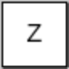 | Pauli Z Gate | `Z` | `{{1, 0}, {0, -1}}` | The phase flip gate. Negates phases when the qubit is ON. |
| 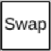 | Swap Gate [Half] | `Swap` | | Swaps the values of two qubits. |
| 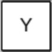 | Pauli Y Gate | `Y` | `{{0, -i}, {i, 0}}` | A combination of the X and Z gates. |
|  | Pauli X Gate | `X` | `{{0, 1}, {1, 0}}` | The NOT gate. Toggles between ON and OFF. |
| 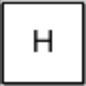 | Hadamard Gate | `H` | `{{√½, √½}, {√½, -√½}}` | Creates simple superpositions. Maps OFF to OFF + ON and ON to OFF − ON, each divided by √2. |

- **Swap** comes in halves: place two in the same column, one on each of the wires to exchange.
- **X** is drawn as ⊕, the usual symbol for the target of a CNOT.

## Quarter Turns

Square roots of the Pauli gates. The two gates in each row of the toolbox are inverses of each other.

| Gate | Name | Id | Matrix | What it does |
|------|------|----|--------|--------------|
| 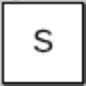 | √Z Gate | `Z^½` or `Z^1/2` | `{{1, 0}, {0, i}}` | Principal square root of Z. Also known as the S gate. |
| 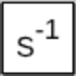 | Z^-½ Gate | `Z^-½` or `Z^-1/2` | `{{1, 0}, {0, -i}}` | Adjoint square root of Z. |
| 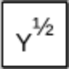 | √Y Gate | `Y^½` or `Y^1/2` | `{{½+½i, -½-½i}, {½+½i, ½+½i}}` | Principal square root of Y. |
| 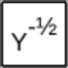 | Y^-½ Gate | `Y^-½` or `Y^-1/2` | `{{½-½i, ½-½i}, {-½+½i, ½-½i}}` | Adjoint square root of Y. |
| 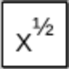 | √X Gate | `X^½` or `X^1/2` | `{{½+½i, ½-½i}, {½-½i, ½+½i}}` | Principal square root of NOT. |
| 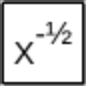 | X^-½ Gate | `X^-½` or `X^-1/2` | `{{½-½i, ½+½i}, {½+½i, ½-½i}}` | Adjoint square root of NOT. |

- These are powers of the Pauli gates, not exponentials: S is `{{1, 0}, {0, i}}`, which differs from Rz(π/2) by a global phase. The difference matters once the gate is controlled. See [Gate powers](../reference/conventions.md#gate-powers).

## Eighth Turns

Fourth roots of the Pauli gates. As with the quarter turns, each row of the toolbox is a gate and its inverse.

| Gate | Name | Id | What it does |
|------|------|----|--------------|
| 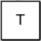 | Z^¼ Gate | `Z^¼` or `Z^1/4` | Principal fourth root of Z. Also known as the T gate. |
| 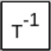 | Z^-¼ Gate | `Z^-¼` or `Z^-1/4` | Adjoint fourth root of Z. |
| 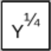 | Y^¼ Gate | `Y^¼` or `Y^1/4` | Principal fourth root of Y. |
| 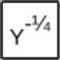 | Y^-¼ Gate | `Y^-¼` or `Y^-1/4` | Adjoint fourth root of Y. |
| 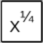 | X^¼ Gate | `X^¼` or `X^1/4` | Principal fourth root of X. |
| 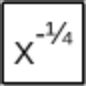 | X^-¼ Gate | `X^-¼` or `X^-1/4` | Adjoint fourth root of X. |

- The T gate's matrix is `{{1, 0}, {0, √½+√½i}}`: it multiplies the ON amplitude by e^(iπ/4).
- Smaller fixed turns, such as `X^⅛`, exist but aren't in the toolbox. See [Unlisted gates](unlisted-gates.md).

## Spinning

Rotations whose amount changes with time, so the circuit animates.
Over one cycle of [time](index.md#time) each gate goes from doing nothing, through the full Pauli gate halfway, and back to doing nothing.

| Gate | Name | Id | What it does |
|------|------|----|--------------|
| 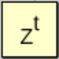 | Z-Raising Gate (forward) | `Z^t` | Right-handed cycle from no-op to Z. |
| 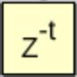 | Z-Raising Gate (backward) | `Z^-t` | Left-handed cycle from no-op to Z. |
| 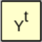 | Y-Raising Gate (forward) | `Y^t` | Right-handed cycle from no-op to Y. |
| 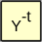 | Y-Raising Gate (backward) | `Y^-t` | Left-handed cycle from no-op to Y. |
| 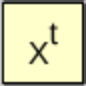 | X-Raising Gate (forward) | `X^t` | Right-handed cycle from no-op to X. |
| 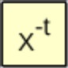 | X-Raising Gate (backward) | `X^-t` | Left-handed cycle from no-op to X. |

- With `t` running from -1 to 1, the forward gates are the Pauli gate raised to the power `t + 1`, and the backward gates raise it to `-(t + 1)`.
- For a rotation that follows your own formula instead, use the [Formulaic](#formulaic) gates.

## Formulaic

Rotations by an amount that you type as a formula.
Click one of these gates in the circuit to change its formula.

| Gate | Name | Id | Starting formula | What it does |
|------|------|----|------------------|--------------|
| 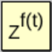 | Formula Z Rotation | `Z^ft` | `sin(pi t)` | Raises Z to the power given by the formula. |
| 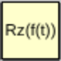 | Formula Rz Gate | `Rzft` | `pi t^2` | Rotates around Z by an angle in radians given by the formula. |
| 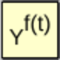 | Formula Y Rotation | `Y^ft` | `sin(pi t)` | Raises Y to the power given by the formula. |
| 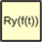 | Formula Ry Gate | `Ryft` | `pi t^2` | Rotates around Y by an angle in radians given by the formula. |
| 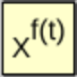 | Formula X Rotation | `X^ft` | `sin(pi t)` | Raises X to the power given by the formula. |
| 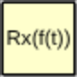 | Formula Rx Gate | `Rxft` | `pi t^2` | Rotates around X by an angle in radians given by the formula. |

- **What a formula can use.** The constants `e` and `pi`, the functions `cos`, `sin`, `acos`, `asin`, `tan`, `atan`, `ln`, `sqrt` and `exp`, the operators `+ - * / ^`, and the [time](index.md#time) variable `t`.
- **Constant gates.** A formula without `t` gives a fixed gate. `Rzft` with the formula `pi/2` is Rz(π/2).
- **Mistakes.** A formula that can't be read, or that doesn't give a real number, marks the gate "bad formula" until it is fixed.
- **In code.** The formula goes in square brackets after the id, as in `Rzft[pi/2] q2`.
- **Size.** The gate grows wider as the formula gets longer, and takes up that many columns.
- **Alternate.** Dragging with *alt* held gives the same gate with the formula negated.
- **Power or angle.** The `^f(t)` gates and the `R` gates differ by a global phase, which matters once they are controlled. See [Gate powers](../reference/conventions.md#gate-powers).

## Parametrized

Rotations by an amount read from other qubits.
Each one needs [input A](toolbox.md#inputs): put an **input A** gate in the same column, or a **Set Default A** gate earlier in the circuit.

| Gate | Name | Id | What it does |
|------|------|----|--------------|
| 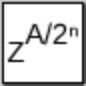 | Parametrized Z Gate | `Z^(A/2^n)` | Rotates the target by input A / 2ⁿ'th of a half turn around the Z axis. |
| 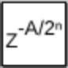 | Parametrized -Z Gate | `Z^(-A/2^n)` | Counter-rotates the target by input A / 2ⁿ'th of a half turn around the Z axis. |
| 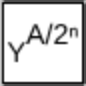 | Parametrized Y Gate | `Y^(A/2^n)` | Rotates the target by input A / 2ⁿ'th of a half turn around the Y axis. |
| 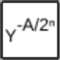 | Parametrized -Y Gate | `Y^(-A/2^n)` | Counter-rotates the target by input A / 2ⁿ'th of a half turn around the Y axis. |
| 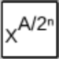 | Parametrized X Gate | `X^(A/2^n)` | Rotates the target by input A / 2ⁿ'th of a half turn around the X axis. |
| 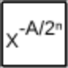 | Parametrized -X Gate | `X^(-A/2^n)` | Counter-rotates the target by input A / 2ⁿ'th of a half turn around the X axis. |

- n is the number of qubits in input A, so the rotation is always less than a half turn.

## Sampling

Detectors measure by sampling: each time the circuit runs they collapse the qubit and report one result.
[Measurement and detectors](../guide/measurement.md#detectors) compares them with the Measurement Gate.

| Gate | Name | Id | What it does |
|------|------|----|--------------|
| 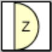 | Z Axis Detector | `ZDetector` | Sampled Z-axis measurement. Shows *click* when the target qubit is \|1⟩ and controls are satisfied. |
| 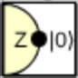 | Z Detect-Control-Reset | `ZDetectControlReset` | Does a sampled Z-axis measurement, controls operations with the result, then resets the target to \|0⟩. |
| 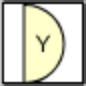 | Y Axis Detector | `YDetector` | Sampled Y-axis measurement. Shows *click* when the target qubit is \|0⟩-i\|1⟩ and controls are satisfied. |
| 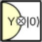 | Y Detect-Control-Reset | `YDetectControlReset` | Does a sampled Y-axis measurement, controls operations with the result, then resets the target to \|0⟩. |
| 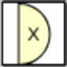 | X Axis Detector | `XDetector` | Sampled X-axis measurement. Shows *click* when the target qubit is \|0⟩-\|1⟩ and controls are satisfied. |
| 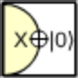 | X Detect-Control-Reset | `XDetectControlReset` | Does a sampled X-axis measurement, controls operations with the result, then resets the target to \|0⟩. |

- A detect-control-reset gate acts as a control for the other gates in its column, using the result it sampled.
- Detectors can be controlled and used as often as you like, but the circuit has to be simulated again for every sample.

## Parity

Controls that condition on several qubits at once.

| Gate | Name | Id | What it does |
|------|------|----|--------------|
|  | Parity Control (Z) | `zpar` | Includes a qubit's Z observable in the column parity control. |
| 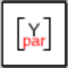 | Parity Control (Y) | `ypar` | Includes a qubit's Y observable in the column parity control. |
|  | Parity Control (X) | `xpar` | Includes a qubit's X observable in the column parity control. |

- Gates in the same column only apply if an odd number of the column's parity controls are satisfied.

## X/Y Probes

The controls and postselection gates of the [Probes](toolbox.md#probes) group, along the X and Y axes instead of the Z axis.

| Gate | Name | Id | What it does |
|------|------|----|--------------|
|  | X-Axis Anti-Control | `⊕` or `xnegctrl` | Conditions on a qubit being \|+⟩. |
|  | X-Axis Control | `⊖` or `xctrl` | Conditions on a qubit being \|-⟩. |
|  | Y-Axis Anti-Control | `⊗` or `ynegctrl` | Conditions on a qubit being \|i⟩. |
|  | Y-Axis Control | `(/)` or `yctrl` | Conditions on a qubit being \|-i⟩. |
|  | Postselect X-Off | `\|+⟩⟨+\|` or `postxoff` | Keeps \|+⟩ states, discards/retries \|-⟩ states. |
|  | Postselect X-On | `\|-⟩⟨-\|` or `postxon` | Keeps \|-⟩ states, discards/retries \|+⟩ states. |
|  | Postselect Y-Off | `\|X⟩⟨X\|` or `postyoff` | Keeps \|i⟩ states, discards/retries \|-i⟩ states. |
|  | Postselect Y-On | `\|/⟩⟨/\|` or `postyon` | Keeps \|-i⟩ states, discards/retries \|i⟩ states. |

- As with the Z-axis controls, gates in the same column only apply to states meeting the condition.
- An X-axis control is a Z-axis control with a Hadamard gate before and after it.
- **The ids of the four controls don't match their labels.** Each control's id is the symbol drawn on its opposite: the X-axis control is drawn as ⊕ but its id is `⊖`. The plain-text names avoid the confusion.
- These controls aren't common in papers or textbooks. See [XYZ controls](../reference/conventions.md#xyz-controls).

## Order

Gates that treat a block of qubits as a number to count with, or that move qubits around.

| Gate | Name | Id | Sizes | What it does |
|------|------|----|-------|--------------|
|  | Counting Gate | `Counting3` | 1–16 | Adds an increasing little-endian count into a block of qubits. |
|  | Down Counting Gate | `Uncounting3` | 1–16 | Subtracts an increasing little-endian count from a block of qubits. |
|  | Reverse Order | `rev2` | 2–16 | Swaps bits into the opposite order. |
|  | Left Rotate | `<<3` | 2–16 | Rotates bits downward. |
|  | Right Rotate | `>>3` | 2–16 | Rotates bits upward. |
|  | Interleave | `weave6` | 4–16 | Re-orders blocks of bits into stripes of bits. |
|  | Deinterleave | `split6` | 4–16 | Re-orders stripes of bits into blocks of bits. |

- **Counting.** The count grows with [time](index.md#time): over one cycle an n-qubit counting gate adds 0, then 1, and so on up to 2ⁿ − 1.
- **Rotating.** Left Rotate moves each qubit's value one wire down, and the bottom wire's value wraps around to the top. Right Rotate is its inverse.
- **Interleaving.** Interleave takes the top half and the bottom half of its wires and alternates them. Deinterleave is its inverse.
## Frequency

The quantum Fourier transform and the phase gradient gates.

| Gate | Name | Id | Sizes | What it does |
|------|------|----|-------|--------------|
|  | Fourier Transform Gate | `QFT2` | 1–16 | Transforms to/from phase frequency space. |
|  | Inverse Fourier Transform Gate | `QFT†2` or `QFTdag2` | 1–16 | Transforms from/to phase frequency space. |
|  | Half Gradient Gate | `PhaseGradient2` | 1–16 | Phases the target by an amount proportional to its value. |
|  | Inverse Half Gradient Gate | `PhaseUngradient2` | 1–16 | Counter-phases the target by an amount proportional to its value. |
|  | Cycling Gradient Gate | `grad^t2` | 1–16 | Phases the target by a cycling amount proportional to its value. |
|  | Inverse Cycling Gradient Gate | `grad^-t2` | 1–16 | Counter-phases the target by a cycling amount proportional to its value. |

- **Half gradient.** On n qubits, the state with value k is multiplied by e^(iπk/2ⁿ). For two qubits that is the diagonal matrix with entries 1, e^(iπ/4), i and e^(3iπ/4).
- **Cycling gradient.** The same idea, with a phase that grows with [time](index.md#time) instead of being fixed.
- The values are read with the top wire as the low bit. See [Qubit order](../reference/conventions.md#qubit-order).

## Inputs

Gates that supply the values A, B and R to gates in the other groups.
They have no effect of their own.

| Gate | Name | Id | Sizes | What it does |
|------|------|----|-------|--------------|
|  | Input Gate [A] | `inputA2` | 1–16 | Temporarily uses some qubits as input A. |
|  | Set Default A | `setA` | | Sets a default value for input A, for when an inline input isn't given. |
|  | Input Gate [B] | `inputB2` | 1–16 | Temporarily uses some qubits as input B. |
|  | Set Default B | `setB` | | Sets a default value for input B, for when an inline input isn't given. |
|  | Input Gate [R] | `inputR2` | 1–16 | Temporarily uses some qubits as input R. |
|  | Set Default R | `setR` | | Sets a default value for input R, for when an inline input isn't given. |

- **Input gates** mark the qubits they cover as a value for the other gates in the same column.
- **Set Default gates** give a fixed number instead, which applies to the columns after them. Click the gate in the circuit to enter a whole number from 0 to 65535. In code the number goes in square brackets, as in `setA[5]`.
- **Which gates use them.** [Parametrized](toolbox.md#parametrized) rotations use A. [Arithmetic](#arithmetic) uses A and B. [Compare](#compare) uses A and B. [Modular](#modular) uses A, B and R.
- A gate that is missing one of its inputs is disabled until the input is supplied.
- Inputs are read with the top wire as the low bit. Input gates with the opposite order exist but aren't in the toolbox. See [Unlisted gates](unlisted-gates.md).

## Arithmetic

Gates that treat the qubits they cover as a little-endian number and do arithmetic on it.
Results wrap around: an n-qubit gate works modulo 2ⁿ.
[Arithmetic](../guide/arithmetic.md) in the guide gives a worked description.

| Gate | Name | Id | Sizes | What it does |
|------|------|----|-------|--------------|
|  | Increment Gate | `inc2` | 1–16 | Adds 1 to the little-endian number represented by a block of qubits. |
|  | Decrement Gate | `dec2` | 1–16 | Subtracts 1 from the little-endian number represented by a block of qubits. |
|  | Addition Gate [input A] | `+=A2` | 1–16 | Adds input A into the qubits covered by this gate. |
|  | Subtraction Gate [input A] | `-=A2` | 1–16 | Subtracts input A out of the qubits covered by this gate. |
|  | Multiply-Add Gate [Inputs A, B] | `+=AB2` | 1–16 | Adds the product of inputs A and B into the qubits covered by this gate. |
|  | Multiply-Subtract Gate [Inputs A, B] | `-=AB2` | 1–16 | Subtracts the product of inputs A and B out of the qubits covered by this gate. |
|  | Multiplication Gate | `*A2` | 1–16 | Multiplies the target by input A. |
|  | Inverse Multiplication Gate | `/A2` | 1–16 | Inverse-multiplies the target by input A (modulo 2ⁿ). |

- The two multiplication gates have no effect when input A is even, because multiplying by an even number modulo 2ⁿ can't be undone.
- More arithmetic gates, such as XOR and square-accumulate, are listed under [Unlisted gates](unlisted-gates.md).

## Compare

Single-qubit gates that toggle their qubit when a comparison between [inputs](#inputs) A and B holds.

| Gate | Name | Id | What it does |
|------|------|----|--------------|
|  | Less-Than Gate | `^A<B` | Toggles a qubit if input A is less than input B. |
|  | Greater-Than Gate | `^A>B` | Toggles a qubit if input A is greater than input B. |
|  | At-Most Gate | `^A<=B` | Toggles a qubit if input A is at most input B. |
|  | At-Least Gate | `^A>=B` | Toggles a qubit if input A is at least input B. |
|  | Equality Gate | `^A=B` | Toggles a qubit if input A is equal to input B. |
|  | Inequality Gate | `^A!=B` | Toggles a qubit if input A isn't equal to input B. |

- The alternate of each gate is its opposite: Less-Than and At-Least, Greater-Than and At-Most, Equality and Inequality.

## Modular

Arithmetic modulo [input R](#inputs) instead of modulo a power of two.
These gates only affect values less than R; larger values are left as they are, which keeps the operation reversible.

| Gate | Name | Id | Sizes | What it does |
|------|------|----|-------|--------------|
|  | Modular Increment Gate | `incmodR2` | 1–16 | Adds 1 into the target, but wraps R-1 to 0. |
|  | Modular Decrement Gate | `decmodR2` | 1–16 | Subtracts 1 out of the target, but wraps 0 to R-1. |
|  | Modular Addition Gate | `+AmodR2` | 1–16 | Adds input A into the target, mod input R. |
|  | Modular Subtraction Gate | `-AmodR2` | 1–16 | Subtracts input A out of the target, mod input R. |
|  | Modular Multiplication Gate | `*AmodR2` | 1–16 | Multiplies the target by input A mod input R. |
|  | Modular Division Gate | `/AmodR2` | 1–16 | Inverse-multiplies the target by input A mod input R. |
|  | Modular Power Multiplication Gate | `*BToAmodR2` | 1–16 | Multiplies the target by input B raised to the input A mod input R. |
|  | Modular Power Division Gate | `/BToAmodR2` | 1–16 | Inverse-multiplies the target by input B raised to the input A mod input R. |

- The four multiplication and division gates have no effect when the multiplication would be irreversible, which happens when the multiplier shares a factor with R.

## Scalar

Gates that multiply the whole state by a number, plus the spacer.
A global phase has no visible effect on its own, but it becomes a relative phase once the gate is controlled.

| Gate | Name | Id | What it does |
|------|------|----|--------------|
|  | Spacer | `…` or `spacer` | A gate with no effect. |
|  | Nothing Gate | `0` | Destroys the universe. |
|  | Ne-Gate | `NeGate` | Negates all amplitudes. |
|  | Imaginary Gate | `i` | Phases everything by i. |
|  | Anti-Imaginary Gate | `-i` | Phases everything by -i. |
|  | Half Imaginary Gate | `√i` or `sqrti` | Phases everything by √i. |
|  | Half Anti-Imaginary Gate | `√-i` or `sqrt-i` | Phases everything by √-i. |

- **Spacer.** Use it to hold a position in a column without doing anything there.
- **Nothing Gate.** A joke gate. Its matrix is all zeros, so every amplitude becomes 0.
- **Ne-Gate.** Multiplies the state by -1.
