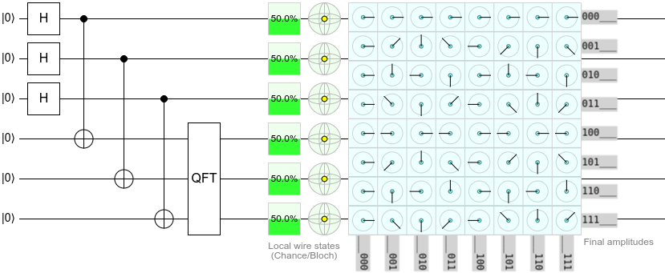

# Advanced techniques

## View the unitary matrix of a circuit via the state channel duality

QubitBoard happens to lay out amplitude displays in a grid, instead of a long thin column.
A happy coincidence of this layout is that, when applying an operation to one half of a set of EPR pairs, the state display shows the matrix of the operation.
(Or rather, amplitudes that are proportional to the entries of the matrix.)

For example, note how the output display of this circuit is showing the matrix of a Fourier transform:

## Edit the circuit as text

Some edits are tedious to do by dragging, such as replacing every Hadamard in a circuit with a Y gate.
You can make them with a text editor's find and replace, either in the [code panel](../code/index.md) or directly in the circuit's link.
See [Circuit links](../reference/circuit-links.md).

## Use gates that aren't in the toolbox

QubitBoard has gates that can only be placed by typing their id.
See [Unlisted gates](../gates/unlisted-gates.md).
