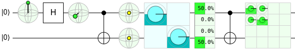
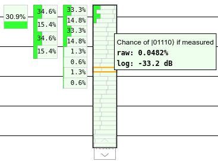
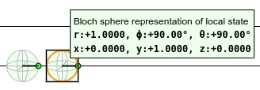
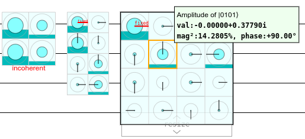
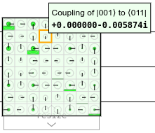
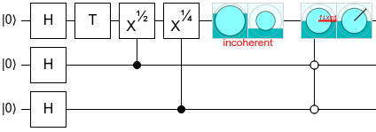
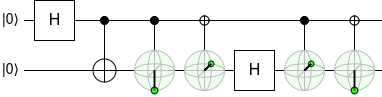

# Displays

A *display* is an object that you place into a circuit in order to view information about the quantum state at particular places and times.
In the real world, it isn't possible to directly access the quantum state of a physical system in this way.
But QubitBoard is a simulator, so it doesn't have to play by those rules.

For example, here is a circuit using (from left to right) Bloch sphere displays, an amplitude display, a chance display, and a density matrix display:

A big part of using QubitBoard effectively amounts to putting the right kind of display in the right place.
In fact, it's often beneficial to perform additional quantum gates purely to make the information shown in the displays more useful.

Here are the four important kinds of displays.

## Chance display

This resizable display shows the probability of computational basis states.
To be more concrete, if you were planning to measure the qubits covered by a chance display in the computation basis (the Z basis), then the chance display shows the probability of each possible measurement result.

You can view the exact probability of a state by hovering your cursor over the chance display.
Visually, the length of each dark green bar is proportional to the probability of one of the states.
Also, because the relevant probabilities get very small in larger systems and the dark green bar gets too small to see, larger chance displays include a logarithmic indicator (the thin gray line).

## Bloch sphere display

This display shows the [Bloch vector representation](https://en.wikipedia.org/wiki/Bloch_sphere) of a single qubit's state.
You can view the exact coordinates by hovering over the display, or just look at the pseudo-3d indicator to get a sense of where it is.

## Amplitude display

The amplitude display is like the chance display, except it shows amplitudes instead of probabilities.
It tells you the quantum amplitude of each computation basis state of the qubits covered by the display.

Each square section in an amplitude display represents one of the amplitudes.
The radius of the light blue circle is the amplitude's magnitude, and the angle of the black line indicator is the amplitude's phase.
The height of the dark blue filling is the squared magnitude of the amplitude; its probability.
Because the global phase of a subsystem is not well defined, QubitBoard will arbitrarily pick one of the amplitudes to use as a phase reference.
This is indicated by the red "fixed" text on one of the phase indicators.
Finally, because amplitudes are often very small, there is a light grey circle whose radius is proportional to the logarithm of the magnitude of the amplitude.

When the qubits covered by the display are entangled with qubits not covered by the display, the amplitude display is not able to show phase information (because there is no well defined phase information in this situation).
When this occurs, the amplitude display will show red warning text ("incoherent") and not show any phase indicator lines.

For convenience reasons, QubitBoard will still show phase information in amplitude displays that are covering measured qubits.
The information is always equivalent to what the state would have been [if the measurements were deferred](https://en.wikipedia.org/wiki/Deferred_Measurement_Principle).

## Density matrix display

The density matrix display is like the amplitude display, except it shows the components of the density matrix of covered qubits instead of the components of the superposition.

The advantage of the density matrix display over the amplitude display is that it works even if there is entanglement between the covered qubits and other qubits.
The downside is that it contains significantly more information; it's harder to read.
As with the amplitude display, the density matrix display shows complex numbers using circles with phase indicators.

## Conditioning displays

An important aspect of using displays effectively is *conditioning* them on other qubits.
For example, suppose you are making a magic state distillation circuit and want to verify that the output is correct *if there are no errors detected*.
You can achieve this goal by placing a display over the output, and placing controls on the error-indicating qubits in the same column.

For example, in the following circuit, we want a T state to be produced on the first qubit when the second and third qubits are off.
If we just put an amplitude display on the first qubit, we aren't able to tell what's going on.
But if we condition on the other two qubits being off, we can see the state we care about.

We can also use controlled displays to get insight into entangled states, by seeing how one qubit's state depends on another along various axes:

