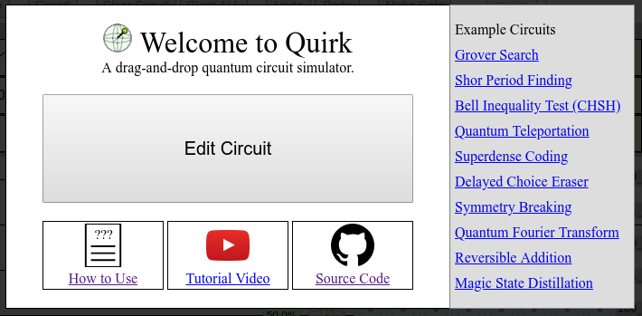
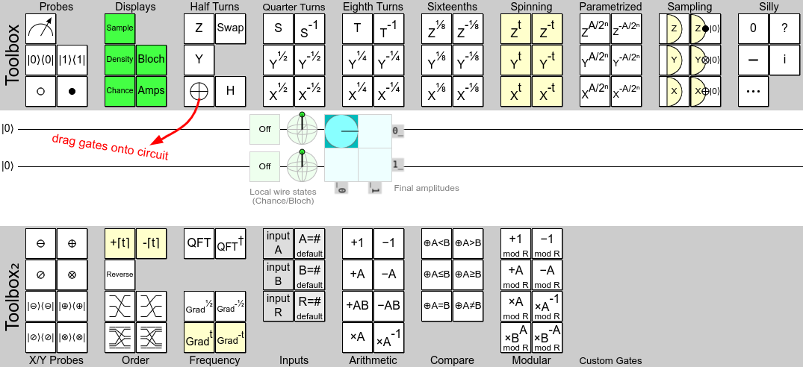

# Getting started

QubitBoard is a drag and drop quantum circuit simulator, great for manipulating and exploring small quantum circuits.
QubitBoard's visual style gives a reasonably intuitive feel of what is happening, state displays update in real time as you change the circuit, and the general experience is fast and interactive.

Using QubitBoard mostly amounts to dragging gates from the toolboxes, dropping those gates into the circuit, and looking at the state displays inside and to the right of the circuit.
If you prefer, you can also write the circuit as code in the [code panel](../code/index.md).
A live version of QubitBoard is available at [rogersmukiibi.com/QubitBoard](https://rogersmukiibi.com/QubitBoard/), but you can also get the code from [github.com/rogersmukiibi/QubitBoard](https://github.com/rogersmukiibi/QubitBoard) and build your own version.

QubitBoard is free and open source software. The source code is available under a permissive Apache license that allows anyone to make and distribute their own modified version.
QubitBoard is a fork of [Quirk](https://github.com/Strilanc/Quirk).

::: tip New to quantum circuits?
QubitBoard assumes you already know background facts like "each wire represents a qubit".
If you're still trying to understand what a quantum circuit *even is*, the video series [Quantum Computing for the Determined](https://www.youtube.com/playlist?list=PL1826E60FD05B44E4) is a good starting point.
:::

## The main menu

When you open QubitBoard with an empty circuit, the following overlay is shown:

This is QubitBoard's main menu.
It provides links to a [tutorial video](https://youtu.be/hiMqqOVrBg0), the source code, and this guide.
It also includes several example circuits that demonstrate common quantum algorithms, experiments, and circuits.

You can dismiss this overlay by clicking "Edit Circuit", pressing the Escape key, or clicking anywhere outside of the overlay.

## The circuit editing area

Almost all the time you spend in QubitBoard will be spent staring at the circuit editing area:

Along the top and bottom are the toolboxes, which contain a variety of quantum gates.
The middle area is showing the circuit.
Each of the long horizontal lines through this area represents a qubit, and objects placed on these lines represent operations to apply to the qubits, working from left to right.
In the very center of the circuit area there are several state displays showing final state of the quantum system.
Docked at the bottom of the window is the [code panel](../code/index.md), which shows the circuit as code.

## Next steps

- [Editing circuits](editing-circuits.md) covers every way to add, move, copy and remove gates.
- [Displays](displays.md) explains the state displays and how to condition them on other qubits.
- [Gates](../gates/index.md) describes every gate in the two toolboxes, group by group.
- [The code panel](../code/index.md) shows how to read and write a circuit as Cirq, OpenQASM 3 or QubitBoard's own language.
- [Controls](../reference/controls.md) is a one-page summary of the mouse and keyboard actions.
