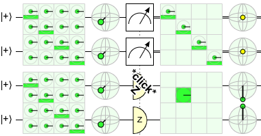

# Measurement and detectors

QubitBoard has a Measurement Gate, but it also has "detectors".
Although these two things represent the same concept, they have significantly different behavior.

Consider the question: if a qubit is in the |+⟩ and you measure it, what is the new state of the qubit?
The answer to this question depends on whether or not you condition on the measurement result.
If you don't condition on the measurement result, the state of the qubit is described by a 2x2 maximally mixed density matrix.
If you do condition on the result, then half of the time the post-measurement state will be |0⟩ and the other half of the time it will be |1⟩.

## The Measurement Gate

When you are attempting to explore all the possible outcomes in a structured way, the first type of measurement is more useful.
The simulation will explore all of the measurement results, and then you can use [controlled displays](displays.md#conditioning-displays) to look at the individual cases at your leisure.
The downside of this approach is that the number of measurements you can do is limited, because the simulation cost becomes unreasonable.
QubitBoard limits the number of measurements of this type by not allowing measured qubits to be unmeasured.

## Detectors

For users who prefer the other type of measurement, QubitBoard has Detectors in its toolbox.
Detectors perform a collapsing measurement, and show a *CLICK* (or not) depending on the result.
Detectors are more flexible than the normal Measurement Gate (e.g. you can control them, you can use lots and lots of them, and they don't lock down a qubit into a bit).
The downside of using Detectors is that they force the circuit to constantly be re-simulated and also QubitBoard doesn't have a mechanism to accumulate statistics over time.
If you want to know information such as "how often is this state correct when the measurement result is ON", you have to use the Measurement Gate and a controlled display instead.
